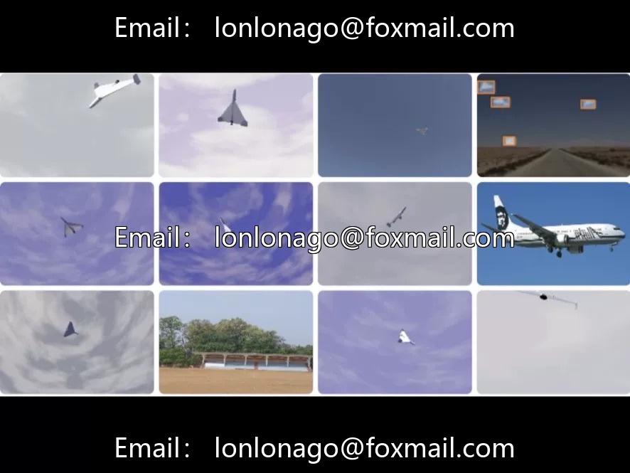
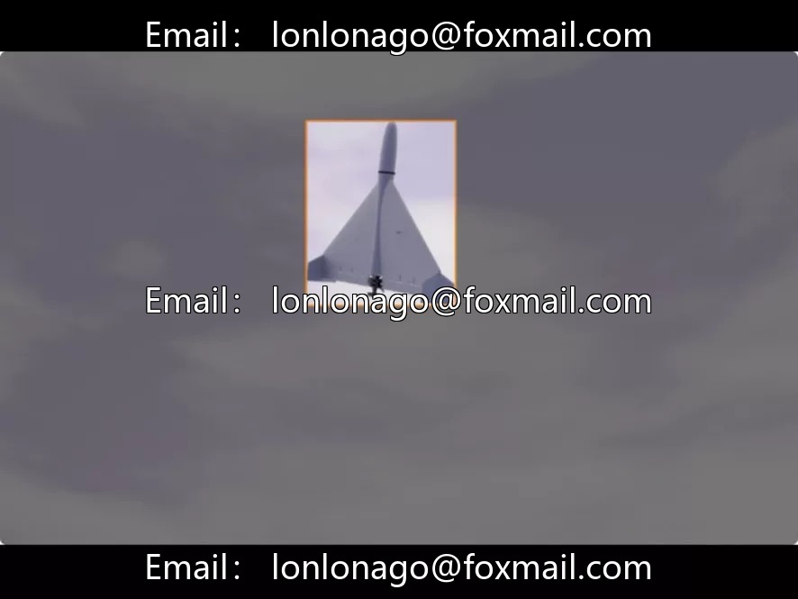
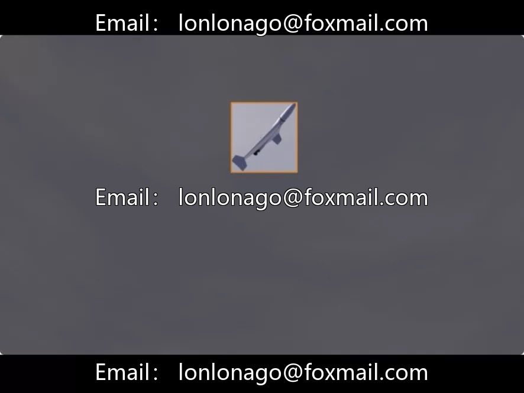

# Minor UAV Target Detection Dataset (Shahed Detection)

## Body

Minor UAV Target Detection Dataset (Shahed Detection Dataset) | Specific UAVs, Anti-UAVs, Low-altitude Security

16900 images in YOLO format, single-class Shahed (Shahed UAV), sufficient scale, focusing on visual detection of this specific model of drone.

The Shahed drone has been widely recognized in recent regional conflicts, often used for reconnaissance or attack missions. Different models of drones differ in size, appearance, speed, and payload capacity, implying different types of missions (reconnaissance, strike, electronic warfare). Visual recognition, as the foundation of the perception layer, can provide key target attribute information for defensive systems, guiding subsequent electronic interference, laser interception and other countermeasures.

Application Scenarios: Key Facility Protection (Airports, Military Bases), Border Patrol, Drone Threat Warning, Defense Decision Making, Intelligence Analysis. The large sample size of 16,900 can support the training of high-reliability detection models, with a single-category focus on specific threat targets, which helps to improve detection accuracy and reduce false alarm rates.

Technical Characteristics: YOLO format annotation, images and labels are one-to-one corresponding, can be directly connected to mainstream frameworks such as YOLOv5/v8. Expandable for fine-grained classification of drone models, prediction of flight intentions, and detection of clustered drones. A multimodal low-altitude fusion perception system can be constructed by combining radar or radio frequency signals. Introduction of video sequential features analysis can assist in trajectory tracking and behavior prediction.

Applicable Directions: Low-altitude security system, anti-drone equipment research and development, military reconnaissance, security monitoring. UAV target detection project suitable for security, military, and low-altitude defense fields.

Virtual materials, once sold, are non-refundable.
Interested friends, click "I want" to proceed.

## Images

## Payment

Here is a pay link on Stripe ( https://buy.stripe.com/3cs8yP7sY87d0vu9AB ). Please contact me lonlonago@foxmail.com after funding $89, and I will send you a complete data files , thank you!

